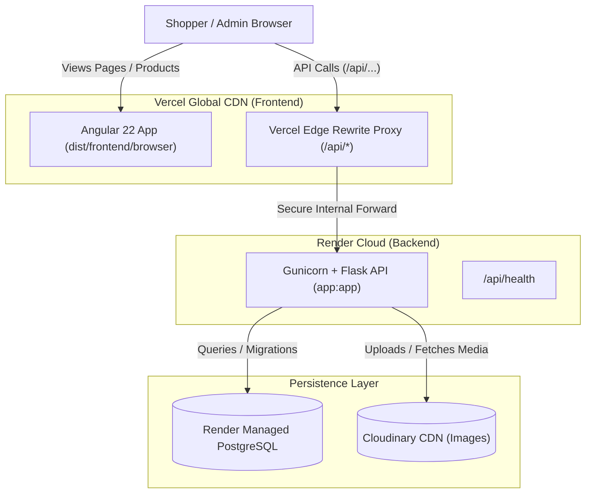

# 🚀 Production Deployment Guide: Render (Backend) + Vercel (Frontend)

This guide provides the complete, step-by-step procedure to deploy the **Shaify Styles** e-commerce platform into production with:
- **Backend API**: Python Flask + Gunicorn + PostgreSQL hosted on [Render](https://render.com)
- **Frontend SPA**: Angular 22 Standalone application hosted on [Vercel](https://vercel.com)
- **Zero CORS Issues**: Direct proxying of `/api/*` requests through Vercel's edge network to Render

---

## 📐 Architecture Overview



---

## 📋 Prerequisites Checklist

Before beginning, ensure you have:
- [x] A [GitHub](https://github.com) account with access to your repository: `ashique543/ShaifyStyles`
- [x] A [Render](https://dashboard.render.com) account (free tier works)
- [x] A [Vercel](https://vercel.com) account (free tier works)
- [ ] *(Optional, recommended)* A free [Cloudinary](https://cloudinary.com) account for persistent product image storage
- [ ] *(Optional)* Razorpay Live API keys (`RAZORPAY_KEY_ID`, `RAZORPAY_KEY_SECRET`)

---

## Part 1: Database Setup on Render (PostgreSQL)

> [!IMPORTANT]
> Render free web services use an **ephemeral filesystem**; local SQLite databases are wiped whenever the container restarts or sleeps. A persistent PostgreSQL database is required for production.

1. Log in to the [Render Dashboard](https://dashboard.render.com).
2. Click **New +** in the top bar and select **PostgreSQL**.
3. Enter the configuration:
   - **Name**: `shaify-db`
   - **Database**: `shaifystyles`
   - **User**: `shaify_user`
   - **Region**: Choose the region closest to your customers (e.g., `Singapore` or `Frankfurt`)
   - **PostgreSQL Version**: `16` (or default)
   - **Instance Type**: **Free**
4. Click **Create Database**.
5. Once provisioned (approx. 1 minute), scroll down to the **Connections** section:
   - Copy the **Internal Database URL** (if backend service is in the same Render region) OR the **External Database URL** (starts with `postgresql://...`).

---

## Part 2: Backend Deployment on Render (Flask Web Service)

### Step 2.1: Create Web Service

1. From the Render Dashboard, click **New +** ➔ **Web Service**.
2. Select **Build and deploy from a Git repository** and connect `ashique543/ShaifyStyles`.
3. Fill in the deployment parameters:

| Field | Configuration Value | Note |
| :--- | :--- | :--- |
| **Name** | `shaify-styles-api` | Will form `https://shaify-styles-api.onrender.com` |
| **Region** | Same region as your database | Minimizes latency |
| **Branch** | `main` | Production branch |
| **Root Directory** | `backend` | ⚠️ **Mandatory**: Tells Render Flask code is in `backend/` |
| **Runtime** | `Python 3` | Native Python runtime |
| **Build Command** | `pip install -r requirements.txt` | Installs Gunicorn, Flask, psycopg2, etc. |
| **Start Command** | `gunicorn -w 4 -b 0.0.0.0:$PORT "app:app"` | Production WSGI server |
| **Instance Type** | **Free** | Spins down after 15m idle |

---

### Step 2.2: Configure Environment Variables in Render

Scroll to the **Environment Variables** section and add the following keys:

| Environment Variable | Value / Format | Purpose |
| :--- | :--- | :--- |
| `DATABASE_URL` | `postgresql://...` *(from Part 1)* | PostgreSQL database connection |
| `FLASK_ENV` | `production` | Production mode flag |
| `SECRET_KEY` | *(Click "Generate" or enter 32+ random chars)* | Flask session & cryptographic security |
| `JWT_SECRET_KEY` | *(Click "Generate" or enter 32+ random chars)* | JWT auth token signature |
| `PYTHON_VERSION` | `3.11.9` | Locks stable Python release |
| `RAZORPAY_KEY_ID` | `rzp_live_...` or test key | Razorpay payment integration |
| `RAZORPAY_KEY_SECRET` | Live or test secret | Razorpay signature validation |
| `CLOUDINARY_CLOUD_NAME` | *(Optional - Cloudinary)* | Persistent cloud media storage |
| `CLOUDINARY_API_KEY` | *(Optional - Cloudinary)* | Cloudinary API Key |
| `CLOUDINARY_API_SECRET` | *(Optional - Cloudinary)* | Cloudinary API Secret |
| `BRAND_NAME` | `Shaify Styles` | Boutique brand display name |
| `WHATSAPP_PHONE` | `919876543210` | Default customer contact number |

4. Click **Create Web Service**.
5. Wait 2–3 minutes for the build to finish.
6. Once deployed, Render will provide your public backend URL, for example:  
   `https://shaify-styles-api.onrender.com`

---

### Step 2.3: Verify Backend Health

Open your browser or terminal and test the health endpoint:
```bash
curl https://shaify-styles-api.onrender.com/api/health
```

Expected JSON response:
```json
{
  "admin_panel": "enabled",
  "brand": "Shaify Styles",
  "database": "connected",
  "instagram": "@shaifystyles_",
  "razorpay_configured": true,
  "status": "healthy"
}
```

---

### Step 2.4: Create the Store Admin Account

To access the `/admin` portal, create the initial store owner account using Render's terminal:

1. In the Render Dashboard, open your `shaify-styles-api` Web Service.
2. Click the **Shell** tab on the left-hand navigation.
3. Run the interactive admin creation command:
   ```bash
   flask create-admin --username admin --email owner@shaifystyles.com
   ```
4. Enter and confirm your secure password when prompted.
5. You should see:
   ```text
   SUCCESS: Admin "admin" created! You can now log in at /admin/login.
   ```

---

## Part 3: Frontend Configuration & Deployment to Vercel

The Angular frontend is pre-configured to send API requests to `/api/*`. By using Vercel's Edge Rewrites proxy in `frontend/vercel.json`, your frontend seamlessly proxies API requests directly to Render without CORS issues or mixed-content SSL errors.

### Step 3.1: Configure `frontend/vercel.json`

Open `frontend/vercel.json` in your local project:

```json
{
  "outputDirectory": "dist/frontend/browser",
  "rewrites": [
    {
      "source": "/api/:path*",
      "destination": "https://YOUR-RENDER-BACKEND-URL.onrender.com/api/:path*"
    },
    {
      "source": "/(.*)",
      "destination": "/index.html"
    }
  ]
}
```

> [!WARNING]
> Replace `https://YOUR-RENDER-BACKEND-URL.onrender.com` with your exact Render Web Service URL from Step 2.2 (e.g. `https://shaify-styles-api.onrender.com`).

Commit and push this change to GitHub:
```bash
git add frontend/vercel.json backend/requirements.txt
git commit -m "Configure production Render backend URL for Vercel proxy"
git push origin main
```

---

### Step 3.2: Deploy on Vercel

1. Log in to [Vercel](https://vercel.com).
2. Click **Add New...** ➔ **Project**.
3. Find your repository `ashique543/ShaifyStyles` and click **Import**.
4. In the **Configure Project** screen:

| Setting | Value | Why it is required |
| :--- | :--- | :--- |
| **Framework Preset** | `Angular` *(or Other)* | Detects Angular build pipelines |
| **Root Directory** | Click **Edit** ➔ select `frontend` | ⚠️ **Mandatory**: Tells Vercel the Angular app is in `frontend/` |
| **Build Command** | `npm run build` *(default)* | Compiles production Angular bundle |
| **Output Directory** | `dist/frontend/browser` | ⚠️ Angular 17+ compiles into `browser/` subfolder |
| **Install Command** | `npm install` *(default)* | Installs Angular dependencies |

5. Click **Deploy**.
6. Deployment will complete in approximately 60–90 seconds. Vercel will assign you an HTTPS URL such as:  
   `https://shaifystyles.vercel.app`

---

## Part 4: Verification & Smoke Testing Checklist

Run through these checks to ensure full operational readiness:

- [ ] **Storefront Loading**: Open your Vercel URL. Ensure the hero banner, product grid, and category tabs load with seeded products.
- [ ] **Dynamic Category Filter**: Click on category pills (e.g., *Modest Fashion*, *Bouquets*). Verify products filter without page reloads.
- [ ] **Cart & Promo Engine**: Add an item to cart, open drawer, apply coupon code `WELCOME10` or `EID2025`. Verify discount calculates correctly.
- [ ] **Customer Authentication**: Click the user profile icon in the navbar. Test Mobile OTP simulation (code: `123456`) or demo Google Sign-In.
- [ ] **Store Owner Admin Login**:
  1. Visit `https://your-vercel-domain.vercel.app/admin/login`.
  2. Log in using the admin credentials created in Step 2.4.
  3. Verify the KPI metric cards (Total Revenue, Orders, Products) render accurately.
- [ ] **In-App Deployment Diagnostics**:
  1. In the admin sidebar, click **🚀 Deployment**.
  2. Confirm database status displays **Production Ready (PostgreSQL)**.

---

## 🛠️ Troubleshooting & Production Tips

### 1. Render Free Tier Spin-Down (Cold Starts)
- **Symptom**: The first visit to the site after 15+ minutes takes 30–50 seconds to load products.
- **Cause**: Render's free tier spins down idle instances to conserve resources.
- **Remedy**: This is normal behavior for free tier. If zero-latency wakeups are required, upgrade the Web Service to the Render **Starter Plan** (\$7/month), or configure an external ping monitor (e.g., UptimeRobot or Cron-job.org) targeting `https://your-backend.onrender.com/api/health` every 10 minutes.

### 2. Angular 404 on Direct Page Refresh
- **Symptom**: Navigating to `https://your-domain.vercel.app/admin` works, but refreshing the page returns `404: NOT_FOUND`.
- **Cause**: Vercel tries to find a static file named `admin` instead of loading the SPA index file.
- **Solution**: Handled automatically by the rewrite in `frontend/vercel.json`:
  ```json
  {
    "source": "/(.*)",
    "destination": "/index.html"
  }
  ```

### 3. API Requests Return HTML Instead of JSON
- **Symptom**: Browser console errors: `SyntaxError: Unexpected token '<', "<!doctype "... is not valid JSON`.
- **Cause**: The rewrite rule `/api/:path*` in `vercel.json` is missing, misconfigured, or placed after the `/(.*)` catch-all.
- **Solution**: Ensure `/api/:path*` is listed **before** `/(.*)` in `frontend/vercel.json` and points to your live Render HTTPS URL.

### 4. Uploaded Product Images Disappear After Server Restart
- **Symptom**: Images uploaded through `/admin` display 404 after a few hours or days.
- **Cause**: Free tier Render Web Services have ephemeral local disk storage.
- **Solution**: Sign up for a free tier [Cloudinary](https://cloudinary.com) account and set `CLOUDINARY_CLOUD_NAME`, `CLOUDINARY_API_KEY`, and `CLOUDINARY_API_SECRET` in your Render Environment Variables. The backend will automatically upload product photos to Cloudinary CDN instead of local disk.

